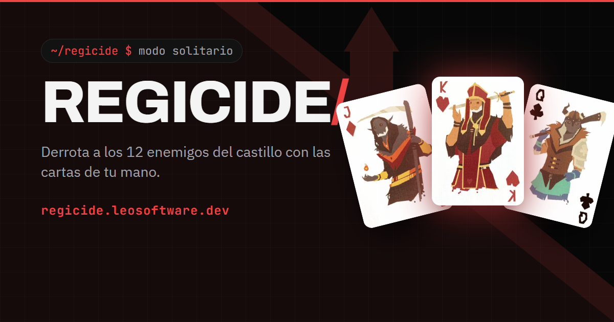

# Regicide

[](https://github.com/manzzaano/Regicide/actions/workflows/ci.yml)


El juego de cartas Regicide en modo solitario, en el navegador. Las reglas viven en un servidor Spring Boot, la partida va en tiempo real por WebSocket y la interfaz está hecha en Angular. Está en producción en **[regicide.leosoftware.dev](https://regicide.leosoftware.dev)**.



Empezó como mi proyecto final de Programación en DAM, en JavaFX. Esta es su segunda versión: la misma partida llevada a la web, con cuentas, clasificación y despliegue propio. Cómo se hizo, fase a fase, está en el [caso de estudio](docs/migracion-a-la-web.md).

## Qué hace

- **Partida completa contra los 12 enemigos del castillo**, con los poderes de los cuatro palos, los dos comodines y las reglas oficiales de Devir.
- **Juega como invitado o con cuenta.** Con cuenta, la partida se guarda en cada jugada y se retoma desde cualquier dispositivo.
- **Clasificación y estadísticas** de tus partidas, con seis jugadores de ejemplo para que nunca salga vacía.
- **Recuperación de la contraseña** por un correo confirmado, que es opcional.
- **Español e inglés**, en la interfaz, los mensajes del servidor y los correos.
- **Adaptada al móvil**, de 320 px de ancho a pantallas de escritorio, sin scroll en ordenador.

## Cómo se juega

Hay que derrotar a 4 sotas (vida 20, ataque 10), 4 reinas (30, 15) y 4 reyes (40, 20). En cada turno atacas con una carta, con 2 a 4 del mismo número que sumen 10 como máximo, o con un as y otra carta. Cada palo tiene un poder: corazones recupera cartas del descarte, diamantes roba, picas baja el ataque del enemigo y tréboles dobla el daño; ninguno funciona contra un enemigo de su mismo palo. Si el enemigo sobrevive, te defiendes descartando cartas que sumen al menos su ataque. Ganas al caer el último rey y pierdes si no puedes atacar o cubrir un golpe.

Las reglas completas, con ejemplos, están en la propia web: [regicide.leosoftware.dev/reglas](https://regicide.leosoftware.dev/reglas).

## Cómo está hecho

- **El servidor manda.** El motor (`com.regicide.juego`) es Java sin dependencias de Spring: guarda todo el estado y valida cada jugada. El navegador solo pinta lo que recibe y nunca conoce el orden del mazo.
- **Cada jugador recibe solo lo suyo.** La partida va por STOMP sobre WebSocket y las respuestas salen a la conexión que las pidió (`@SendToUser`), nunca a un tema compartido.
- **Partidas reproducibles.** El reparto depende de un `Random` que se inyecta, así que los tests juegan partidas enteras con semilla fija y comprueban que las 52 cartas se conservan en cada turno.
- **Cuentas con cuidado.** Argon2id, contraseñas de 15 a 128 caracteres comprobadas contra filtraciones conocidas (Have I Been Pwned), límite de intentos por IP, tokens JWT que se invalidan al cerrar sesión o cambiar la contraseña, y enlaces de recuperación que se guardan como hash y viajan en el fragmento de la URL.
- **Esquema solo con Flyway.** Hibernate se limita a validar; cada cambio de la base de datos es una migración.
- **Errores con código.** Los mensajes salen traducidos con `MessageSource` según `Accept-Language`, y los errores de la partida llevan un `codigo` estable para que el cliente no dependa del texto.
- **Tests de verdad.** Más de 160 en el backend, con un PostgreSQL real por Testcontainers y un cliente STOMP que juega partidas completas contra el servidor arrancado, y 65 en el frontend con Vitest.

## Stack

| | |
|---|---|
| Backend | Java 21, Spring Boot 4.1 (Web, WebSocket, Security, OAuth2 Resource Server, Data JPA), Flyway |
| Base de datos | PostgreSQL 18 |
| Frontend | Angular 22 (componentes standalone, signals, sin zone.js), STOMP.js, Vitest |
| Correo | Resend |
| Infraestructura | Docker Compose, nginx con CSP estricta, Caddy para el HTTPS |
| CI | GitHub Actions: tests y `verify` del backend, tests, build y `npm audit` del frontend, revisión de dependencias y prueba del Compose completo |
| Producción | Máquina gratuita de Oracle Cloud (ARM) |

## En local

Todo con Docker:

```bash
git clone https://github.com/manzzaano/Regicide.git
cd Regicide
cp .env.example .env         # cambia la contraseña de la base de datos y el secreto JWT
docker compose up --build    # http://localhost:8081
```

Cada parte por separado necesita JDK 21, Node 22.22 o superior y Docker, que los tests del backend usan para levantar su propio PostgreSQL:

```bash
# backend: tests y servidor en http://localhost:8080
cd backend
./mvnw test
docker run -d --name regicide-db -p 5432:5432 -e POSTGRES_DB=regicide -e POSTGRES_USER=regicide -e POSTGRES_PASSWORD=regicide postgres:18-alpine
DB_URL=jdbc:postgresql://localhost:5432/regicide DB_USER=regicide DB_PASSWORD=regicide \
JWT_SECRET=un-secreto-de-al-menos-32-caracteres ./mvnw spring-boot:run

# frontend, en otra terminal: http://localhost:4200, redirige /api y /ws al backend
cd frontend
npm install
npm test -- --watch=false
npx ng serve
```

Sin `RESEND_API_KEY` los correos no se envían: se escriben en el log.

## Despliegue

En el servidor, con el dominio en `DOMINIO` dentro de `.env` y los puertos 80 y 443 abiertos, el mismo Compose se arranca junto a `docker-compose.prod.yml`, que añade Caddy y el certificado HTTPS:

```bash
docker compose -f docker-compose.yml -f docker-compose.prod.yml up -d --build
```

## API

Rutas públicas:

| Método | Ruta | Cuerpo |
|---|---|---|
| `POST` | `/api/auth/register` | `{"nombre", "contrasena", "correo"}` (correo opcional), responde `{"token"}` |
| `POST` | `/api/auth/login` | `{"nombre", "contrasena"}`, responde `{"token"}` |
| `POST` | `/api/auth/olvide` | `{"nombre"}` |
| `POST` | `/api/auth/restablecer` | `{"enlace", "nueva"}` |
| `POST` | `/api/auth/correo/confirmar` | `{"enlace"}` |
| `GET` | `/api/leaderboard` | |

Con `Authorization: Bearer <token>`:

| Método | Ruta | Cuerpo |
|---|---|---|
| `GET` | `/api/games/me` | |
| `GET` | `/api/auth/cuenta` | |
| `POST` | `/api/auth/salir` | cierra la sesión en todos los dispositivos |
| `POST` | `/api/auth/contrasena` | `{"actual", "nueva"}` |
| `POST` | `/api/auth/correo` | `{"correo", "contrasena"}`; vacío, quita el correo |
| `POST` | `/api/auth/borrar` | `{"contrasena"}` |

La partida va por WebSocket en `/ws`. El cliente envía a `/app/partida/{empezar,retomar,atacar,defender,comodin,abandonar}`; `atacar` y `defender` llevan `{"cartas": [posiciones en la mano]}`. El estado llega a `/user/queue/partida` y los errores, como `{"codigo", "mensaje"}`, a `/user/queue/errores`. Con cuenta, el token va en la cabecera `Authorization` del CONNECT; sin ella se juega como invitado y no se guarda nada.

## Estructura

```
Regicide/
├── backend/     Spring Boot
│   └── src/main/java/com/regicide/
│       ├── juego/     el motor: reglas y estado, sin Spring
│       ├── partida/   la partida por STOMP, su guardado y la clasificación
│       └── cuenta/    registro, sesiones y correo
├── frontend/    Angular: las pantallas y la conexión STOMP, sin reglas
├── docs/        caso de estudio de la migración
└── .github/     CI y Dependabot
```

## Versiones

| | |
|---|---|
| [`v2.0.0`](https://github.com/manzzaano/Regicide/releases/tag/v2.0.0) | La versión web, la que está en producción. |
| [`v1`](https://github.com/manzzaano/Regicide/tree/v1) | La versión JavaFX, tal como la entregué en DAM. |
| [`archivo/web-old`](https://github.com/manzzaano/Regicide/tree/archivo/web-old) | Un primer intento web, archivado por sus fallos. |

---

Hecho por [Ismael Manzano León](https://leosoftware.dev) · [LinkedIn](https://www.linkedin.com/in/ismael-manzano-leon/)
