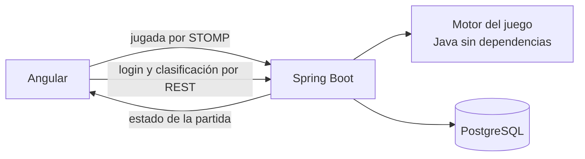

# Regicide: de JavaFX a la web

Caso de estudio de la migración. Recoge de dónde parto, qué quiero conseguir, las decisiones que tomo y por qué, y en qué fase está el trabajo. Lo actualizo al cerrar cada fase.

## Resumen

Regicide fue mi proyecto final de Programación en DAM: un juego de cartas en JavaFX, hecho en cuatro días, que solo funcionaba en mi ordenador. Lo llevo a la web con las reglas en un servidor Spring Boot, la partida en tiempo real por WebSocket, cuentas de usuario y una clasificación. El juego tiene que ser el mismo; lo que cambia es dónde vive cada parte.

## Punto de partida: la versión 1

La versión entregada está en la rama [`v1`](https://github.com/manzzaano/Regicide/tree/v1). Funciona y se puede jugar entera, pero está pensada para un único programa de escritorio:

| Lo que encontré | Por qué impide llevarlo a la web |
|---|---|
| Las reglas están dentro de `ControladorJuego` (499 líneas), mezcladas con los botones y las imágenes | No se pueden ejecutar en un servidor sin arrastrar JavaFX |
| La fase del turno es un texto (`"ataque"`, `"defensa"`) | Nada impide una acción fuera de su fase |
| Las partidas y las estadísticas se escriben en `src/main/resources` con rutas relativas | Solo funciona desde la carpeta del proyecto, y en un servidor varios jugadores escribirían en los mismos ficheros |
| El número de partida se calcula contando los ficheros guardados | Dos partidas a la vez tendrían el mismo número |
| JUnit está en el `pom.xml`, pero no hay ningún test | No hay forma de saber si una regla sigue igual después de moverla |
| 64 ficheros compilados (`target/`, `out/`) están en el repositorio | Ruido en cada cambio |

El modelo (`Juego`, `Baraja` y las cartas) sí se puede aprovechar, y las reglas del juego son las que quiero mantener.

## Un primer intento

Antes de este trabajo hice una primera versión web, guardada en la rama [`web-old`](https://github.com/manzzaano/Regicide/tree/web-old). Al revisarla vi que no cumplía lo que quería contar de ella: el estado de cada partida se enviaba a todos los jugadores conectados, no tenía tests, las partidas jugadas no se guardaban en el servidor y GitHub marcaba 95 vulnerabilidades en sus dependencias. En vez de parchearla, empiezo otra vez desde v1, por fases y con tests desde el principio.

## Objetivo

- **La partida vive en el servidor.** El navegador envía la jugada; el servidor la valida, la resuelve y devuelve el estado nuevo.
- **Cada turno es una máquina de estados:** ataque, defensa, victoria y derrota.
- **Las reglas de v1:** poderes de los palos, el as como compañero y dos comodines.
- **Tiempo real con WebSocket y STOMP,** y cada jugador recibe solo su partida.
- **Cuentas y clasificación** con JWT, Spring Security, PostgreSQL y JPA.
- **El sistema completo se levanta con Docker Compose** y se publica para que se pueda jugar desde cualquier navegador.

## Decisiones

| Decisión | Por qué | Lo que descarto |
|---|---|---|
| El motor del juego es Java sin Spring ni JavaFX | Se prueba con tests rápidos y no depende de cómo se muestre | Reglas dentro de los controladores, como en v1 |
| Las fases son un `enum` y cada acción comprueba la fase | Una jugada fuera de turno se rechaza en un solo sitio | La fase como texto |
| El `Random` se pasa al motor desde fuera | Los tests reparten siempre las mismas cartas y son repetibles | Barajar dentro del motor sin control |
| Cada jugador recibe su estado en `/user/queue/game` | Nadie ve la partida de otro | Un tema compartido (`/topic/game`), el fallo de la primera versión |
| El estado que se envía no incluye el orden de la posada | El cliente no puede saber qué carta viene | Enviar el objeto del juego entero |
| El servidor guarda la partida al terminar | Es quien sabe el resultado | Un endpoint donde el cliente diga "he ganado" |
| Se puede jugar sin cuenta | La cuenta solo hace falta para aparecer en la clasificación | Obligar a registrarse para probar el juego |
| Esquema de base de datos con migraciones de Flyway | Cada cambio de tablas queda versionado | `ddl-auto: update` |
| Sin `JWT_SECRET` o sin base de datos, el backend no arranca | Un error de configuración se ve al momento | Valores por defecto inseguros |

## Versiones

| Pieza | Versión |
|---|---|
| Java | 21 |
| Spring Boot | 4.1 |
| Angular | 22 |
| PostgreSQL | 18 |

## Fases

| Fase | Contenido | Estado |
|---|---|---|
| 1 | Motor del juego en Java, con tests de cada regla | Pendiente |
| 2 | Backend: la partida por WebSocket | Pendiente |
| 3 | Cuentas y clasificación | Pendiente |
| 4 | Frontend en Angular | Pendiente |
| 5 | Docker Compose y CI | Pendiente |
| 6 | Publicación | Pendiente |

Cada fase se desarrolla en la rama `dev` y llega a `master` con un pull request.

### Fase 1. Motor del juego

1. Proyecto Maven del backend con JUnit 5.
2. Modelo: cartas, palos (`enum`), enemigos, mano, posada, descarte y castillo.
3. Reparto inicial: 8 cartas del 1 al 10 en la mano, el castillo con jotas, reinas y reyes barajados por grupo y el resto en la posada.
4. Máquina de estados: `ATAQUE`, `DEFENSA`, `VICTORIA` y `DERROTA`.
5. Ataque: una carta, varias del mismo número y distinto palo que sumen 10 como máximo, o un as junto a otra carta.
6. Poderes de los palos e inmunidad contra un enemigo del mismo palo.
7. Enemigo derrotado: con la vida justa a 0 pasa a la posada; si no, al descarte.
8. Defensa: descartar hasta cubrir el ataque del enemigo.
9. Comodines: dos por partida; descartan la mano y roban 8 cartas.
10. Fin de partida.
11. Retirar el código JavaFX de `master`; queda en la rama `v1`.

Terminada cuando todas las reglas tienen tests en verde y una partida completa se juega desde un test.

### Fase 2. La partida por WebSocket

1. Endpoint STOMP y acciones: empezar, atacar, defender, usar comodín y abandonar.
2. Una partida por jugador, con el estado enviado solo a quien juega.
3. Validación de cada mensaje: cartas que están en la mano y acción permitida en la fase.
4. Errores devueltos al jugador como mensaje.
5. Las partidas abandonadas se borran al cerrarse la conexión.
6. Tests de integración del flujo completo.

Terminada cuando una partida se juega entera con un cliente de test y dos jugadores a la vez no ven la partida del otro.

### Fase 3. Cuentas y clasificación

1. PostgreSQL con JPA y Flyway.
2. Registro e inicio de sesión con contraseñas cifradas con BCrypt y JWT.
3. El JWT también en la conexión STOMP.
4. Partida guardada por el servidor al terminar, si el jugador tiene sesión.
5. API REST: `POST /api/auth/register`, `POST /api/auth/login`, `GET /api/leaderboard` y `GET /api/games/me`.
6. Orígenes permitidos (CORS y WebSocket) leídos de la configuración.
7. Tests de seguridad: rutas protegidas sin token, token caducado y registro duplicado.

Terminada cuando una partida jugada con sesión aparece en la clasificación.

### Fase 4. Frontend en Angular

1. Componentes standalone y rutas con carga diferida.
2. Servicio STOMP con el estado de la partida.
3. Pantallas: inicio, partida, reglas, clasificación, registro e inicio de sesión.
4. La partida solo pinta el estado y envía jugadas; no calcula ninguna regla.
5. Las imágenes de las cartas de v1.
6. Diseño adaptado a móvil, tablet y escritorio, con contraste alto en modo claro y oscuro.
7. Tests de los servicios y de los componentes con lógica.

Terminada cuando se juega una partida completa en el navegador, con cuenta y sin ella.

### Fase 5. Docker Compose y CI

1. Dockerfile del backend y del frontend (nginx), en varias etapas.
2. `docker-compose.yml` con PostgreSQL, backend y frontend, healthchecks que comprueban algo real y un `.env.example`.
3. GitHub Actions: tests del backend, tests y build del frontend y auditoría de dependencias.
4. Dependabot.

Terminada cuando `docker compose up --build` levanta el sistema desde cero y el CI está en verde.

### Fase 6. Publicación

1. Elegir dónde alojar el backend y la base de datos sin coste, comparando sus límites.
2. Frontend en Vercel, apuntando al backend publicado.
3. Comprobar que la web y la API responden y jugar una partida en producción.
4. README con el enlace para jugar y el estado real.

Terminada cuando se puede jugar desde la URL publicada.

## Reglas: cambios respecto a v1

Las reglas son las de v1. Cuando al pasarlas al motor encuentre un fallo, lo anoto aquí con la decisión.

| Regla | En v1 | En la versión web |
|---|---|---|
| Tréboles contra un enemigo de Tréboles | Dobla el daño igualmente | Pendiente de decidir en la fase 1 (las reglas oficiales lo impiden) |

## Pendiente de decidir

| Tema | Cuándo |
|---|---|
| Inmunidad de Tréboles | Fase 1 |
| Diferencias de v1 con las reglas oficiales de Regicide | Fase 1 |
| Alojamiento del backend | Fase 6 |
