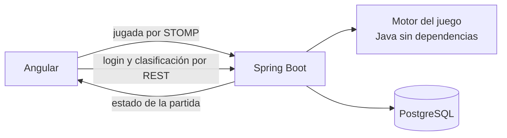

# Regicide: de JavaFX a la web

Caso de estudio de la migración. Recoge de dónde parto, qué quiero conseguir, las decisiones que tomo y por qué, y en qué fase está el trabajo. Lo actualizo al cerrar cada fase.

## Resumen

Regicide fue mi proyecto final de Programación en DAM: un juego de cartas en JavaFX, hecho en cuatro días, que solo funcionaba en mi ordenador. Lo llevo a la web con las reglas en un servidor Spring Boot, la partida en tiempo real por WebSocket, cuentas de usuario y una clasificación. El juego tiene que ser el mismo; lo que cambia es dónde vive cada parte.

## Punto de partida: la versión 1

La versión entregada está en la rama [`v1`](https://github.com/manzzaano/Regicide/tree/v1). Funciona y se puede jugar entera, pero está pensada para un único programa de escritorio:

| Lo que encontré | Por qué impide llevarlo a la web |
|---|---|
| Las reglas están dentro de `ControladorJuego` (499 líneas), mezcladas con los botones y las imágenes | No se pueden ejecutar en un servidor sin arrastrar JavaFX |
| La fase del turno es un texto (`"ataque"`, `"defensa"`) | Nada impide una acción fuera de su fase |
| Las partidas y las estadísticas se escriben en `src/main/resources` con rutas relativas | Solo funciona desde la carpeta del proyecto, y en un servidor varios jugadores escribirían en los mismos ficheros |
| El número de partida se calcula contando los ficheros guardados | Dos partidas a la vez tendrían el mismo número |
| JUnit está en el `pom.xml`, pero no hay ningún test | No hay forma de saber si una regla sigue igual después de moverla |
| 64 ficheros compilados (`target/`, `out/`) están en el repositorio | Ruido en cada cambio |

El modelo (`Juego`, `Baraja` y las cartas) sí se puede aprovechar, y las reglas del juego son las que quiero mantener.

## Un primer intento

Antes de este trabajo hice una primera versión web, guardada en la rama [`web-old`](https://github.com/manzzaano/Regicide/tree/web-old). Al revisarla vi que no cumplía lo que quería contar de ella: el estado de cada partida se enviaba a todos los jugadores conectados, no tenía tests, las partidas jugadas no se guardaban en el servidor y GitHub marcaba 95 vulnerabilidades en sus dependencias. En vez de parchearla, empiezo otra vez desde v1, por fases y con tests desde el principio.

## Objetivo

- **La partida vive en el servidor.** El navegador envía la jugada; el servidor la valida, la resuelve y devuelve el estado nuevo.
- **Cada turno es una máquina de estados:** ataque, defensa, victoria y derrota.
- **Las reglas de v1:** poderes de los palos, el as como compañero y dos comodines.
- **Tiempo real con WebSocket y STOMP,** y cada jugador recibe solo su partida.
- **Cuentas y clasificación** con JWT, Spring Security, PostgreSQL y JPA.
- **El sistema completo se levanta con Docker Compose** y se publica para que se pueda jugar desde cualquier navegador.

## Decisiones

| Decisión | Por qué | Lo que descarto |
|---|---|---|
| El motor del juego es Java sin Spring ni JavaFX | Se prueba con tests rápidos y no depende de cómo se muestre | Reglas dentro de los controladores, como en v1 |
| Las fases son un `enum` y cada acción comprueba la fase | Una jugada fuera de turno se rechaza en un solo sitio | La fase como texto |
| El `Random` se pasa al motor desde fuera | Los tests reparten siempre las mismas cartas y son repetibles | Barajar dentro del motor sin control |
| Cada jugador recibe su estado en `/user/queue/partida` | Nadie ve la partida de otro | Un tema compartido (`/topic/game`), el fallo de la primera versión |
| El estado que se envía no incluye el orden de la posada | El cliente no puede saber qué carta viene | Enviar el objeto del juego entero |
| El servidor guarda la partida al terminar | Es quien sabe el resultado | Un endpoint donde el cliente diga "he ganado" |
| Se puede jugar sin cuenta | La cuenta solo hace falta para aparecer en la clasificación y retomar partidas | Obligar a registrarse para probar el juego |
| Con cuenta, la partida a medias se guarda en PostgreSQL tras cada jugada | v1 permitía guardar y cargar una partida (lo pedía la entrega 2); así el juego sigue siendo el mismo | Perder la partida al cerrar el navegador, o un botón de guardar que el jugador puede olvidar |
| Esquema de base de datos con migraciones de Flyway | Cada cambio de tablas queda versionado | `ddl-auto: update` |
| Sin `JWT_SECRET` o sin base de datos, el backend no arranca | Un error de configuración se ve al momento | Valores por defecto inseguros |

## Versiones

| Pieza | Versión |
|---|---|
| Java | 21 |
| Spring Boot | 4.1 |
| Angular | 22 |
| PostgreSQL | 18 |

## Fases

| Fase | Contenido | Estado |
|---|---|---|
| 1 | Motor del juego en Java, con tests de cada regla | Terminada |
| 2 | Backend: la partida por WebSocket | Terminada |
| 3 | Cuentas y clasificación | Terminada |
| 4 | Frontend en Angular | Pendiente |
| 5 | Docker Compose y CI | Pendiente |
| 6 | Publicación | Pendiente |

Cada fase se desarrolla en la rama `dev` y llega a `master` con un pull request.

### Fase 1. Motor del juego

1. Proyecto Maven del backend con JUnit 5.
2. Modelo: cartas, palos (`enum`), enemigos, mano, posada, descarte y castillo.
3. Reparto inicial: 8 cartas del 1 al 10 en la mano, el castillo con jotas, reinas y reyes barajados por grupo y el resto en la posada.
4. Máquina de estados: `ATAQUE`, `DEFENSA`, `VICTORIA` y `DERROTA`.
5. Ataque: una carta, varias del mismo número que sumen 10 como máximo, o un as junto a una única carta.
6. Poderes de los palos e inmunidad contra un enemigo del mismo palo.
7. Enemigo derrotado: con la vida justa a 0 pasa a la posada; si no, al descarte.
8. Defensa: descartar hasta cubrir el ataque del enemigo.
9. Comodines: dos por partida; descartan la mano y roban 8 cartas.
10. Fin de partida.
11. Retirar el código JavaFX de `master`; queda en la rama `v1`.

Terminada cuando todas las reglas tienen tests en verde y una partida completa se juega desde un test.

**Resultado.** El motor está en `backend/src/main/java/com/regicide/juego`: seis clases y 333 líneas, frente a las 499 de `ControladorJuego` en v1. `Partida` es la única con lógica y expone tres acciones (`atacar`, `defender` y `usarComodin`); una jugada que las reglas no permiten lanza `JugadaNoValida` con un mensaje para el jugador. Tiene 74 tests: 54 de reglas concretas y 20 partidas completas con semillas distintas, que comprueban en cada turno que las 52 cartas siguen en juego. Al escribir los tests de cada regla salieron los seis fallos de v1 que recoge la tabla de reglas.

### Fase 2. La partida por WebSocket

1. Endpoint STOMP y acciones: empezar, atacar, defender, usar comodín y abandonar.
2. Una partida por jugador, con el estado enviado solo a quien juega.
3. Validación de cada mensaje: cartas que están en la mano y acción permitida en la fase.
4. Errores devueltos al jugador como mensaje.
5. Las partidas abandonadas se borran al cerrarse la conexión.
6. Tests de integración del flujo completo.

Terminada cuando una partida se juega entera con un cliente de test y dos jugadores a la vez no ven la partida del otro.

**Resultado.** El paquete `com.regicide.partida` conecta el motor con STOMP. El navegador abre `/ws` y envía sus jugadas a `/app/partida/empezar`, `atacar`, `defender`, `comodin` y `abandonar`; el estado vuelve solo a esa conexión en `/user/queue/partida` y los errores en `/user/queue/errores`. Cada conexión tiene una partida en memoria, que se borra al abandonar o al desconectarse. El servidor procesa en orden los mensajes de cada conexión, así que dos jugadas seguidas del mismo jugador nunca se cruzan. El estado que se envía (`EstadoPartida`) lleva la mano, el enemigo y cuántas cartas hay en cada mazo, pero no su orden. Los orígenes desde los que se puede abrir el WebSocket se leen de la configuración (`regicide.origenes-permitidos`), así que ese punto de la fase 3 queda hecho para el WebSocket. Se añaden 12 tests de integración con un cliente STOMP real, entre ellos una partida entera por WebSocket, dos jugadores conectados a la vez y mensajes mal formados; el backend suma 86 tests.

### Fase 3. Cuentas y clasificación

1. PostgreSQL con JPA y Flyway.
2. Registro e inicio de sesión con contraseñas cifradas con BCrypt y JWT.
3. El JWT también en la conexión STOMP.
4. Partida guardada por el servidor al terminar, si el jugador tiene sesión.
5. Partida a medias: con sesión, el estado completo (mano, posada en su orden, descarte, castillo, comodines y fase) se guarda tras cada jugada y se retoma al volver a conectarse. Sin cuenta, se pierde al cerrar la conexión.
6. API REST: `POST /api/auth/register`, `POST /api/auth/login`, `GET /api/leaderboard` y `GET /api/games/me`.
7. Orígenes permitidos (CORS y WebSocket) leídos de la configuración.
8. Tests de seguridad: rutas protegidas sin token, token caducado y registro duplicado.

Terminada cuando una partida jugada con sesión aparece en la clasificación y una partida a medias se retoma después de desconectarse.

**Resultado.** El paquete `com.regicide.cuenta` registra jugadores e inicia sesión: la contraseña se guarda cifrada con BCrypt y el servidor responde con un JWT firmado con HS256 que dura 24 horas. Si falla el nombre o la contraseña, el mensaje es el mismo y no dice cuál de los dos está mal. Las rutas públicas ignoran el token, así que uno caducado no impide ver la clasificación. El navegador envía el token en la cabecera `Authorization` del CONNECT de STOMP; sin token se juega como invitado y con un token falso o caducado se rechaza la conexión. Con sesión, el servidor guarda tras cada jugada el estado completo del motor en una columna `jsonb` (una partida a medias por jugador); al volver, el jugador envía `/app/partida/retomar` y recibe la partida tal como la dejó. Al terminar, la partida pasa al historial (`GET /api/games/me`) y cuenta para la clasificación (`GET /api/leaderboard`), que ordena por victorias, después por la mejor partida y, a igualdad, por menos partidas jugadas. Las tablas se crean con dos migraciones de Flyway y Hibernate solo valida el esquema. Los tests de integración levantan un PostgreSQL real con Testcontainers. Se añaden 26 tests: 3 del motor para exportar y reconstruir una partida, 17 de cuentas y seguridad (registro duplicado, datos no válidos, contraseñas de más de 72 bytes, que BCrypt no admite, rutas sin token, token caducado y token firmado con otra clave) y 6 de partidas con sesión; el backend suma 112 tests.

### Fase 4. Frontend en Angular

1. Componentes standalone y rutas con carga diferida.
2. Servicio STOMP con el estado de la partida.
3. Pantallas: inicio, partida, reglas, clasificación, registro e inicio de sesión.
4. La partida solo pinta el estado y envía jugadas; no calcula ninguna regla.
5. Las imágenes de las cartas de v1.
6. Diseño adaptado a móvil, tablet y escritorio, con contraste alto en modo claro y oscuro.
7. Tests de los servicios y de los componentes con lógica.

Terminada cuando se juega una partida completa en el navegador, con cuenta y sin ella.

### Fase 5. Docker Compose y CI

1. Dockerfile del backend y del frontend (nginx), en varias etapas.
2. `docker-compose.yml` con PostgreSQL, backend y frontend, healthchecks que comprueban algo real y un `.env.example`.
3. GitHub Actions: tests del backend, tests y build del frontend y auditoría de dependencias.
4. Dependabot.

Terminada cuando `docker compose up --build` levanta el sistema desde cero y el CI está en verde.

### Fase 6. Publicación

1. Elegir dónde alojar el backend y la base de datos sin coste, comparando sus límites.
2. Frontend en Vercel, apuntando al backend publicado.
3. Comprobar que la web y la API responden y jugar una partida en producción.
4. README con el enlace para jugar y el estado real.

Terminada cuando se puede jugar desde la URL publicada.

## Reglas: cambios respecto a v1

Las reglas del juego son las que fijé para el proyecto en clase: los enunciados de las cuatro entregas y el reglamento oficial de Regicide en español (Devir), que v1 abre desde el botón "¿Cómo jugar?". Al pasar v1 al motor encontré seis puntos en los que el código no cumplía ese reglamento. En la versión web se corrigen:

| Regla | En v1 | Según el reglamento |
|---|---|---|
| Tréboles contra un enemigo de Tréboles | Dobla el daño igualmente | No lo dobla: cada enemigo es inmune al poder de su palo, también Tréboles. La entrega final también lo pedía ("tener en cuenta el palo de los enemigos") |
| Compañero animal (as) | Se pueden juntar varios ases con otra carta | El as se juega solo o con una única carta, que puede ser otro as |
| Cartas curadas con Corazones | Van encima de la posada y se roban enseguida | Van debajo de la posada |
| Cartas jugadas contra un enemigo derrotado con la vida justa | Se quedan en el mazo de jugadas | Pasan al descarte, igual que cuando se derrota con daño de sobra |
| Comodines al defenderse | No se pueden usar | Se pueden usar al empezar el paso 1 (antes de atacar) o el paso 4 (antes de recibir daño) |
| Figuras robadas de la posada | Valen su número: 11, 12 y 13 | La sota vale 10, la reina 15 y el rey 20 |

Lo que el reglamento deja a elección o no aplica a una partida de un jugador se queda como en v1: no se puede pasar el turno y no hay niveles de victoria (oro, plata y bronce).

## Pendiente de decidir

| Tema | Cuándo |
|---|---|
| Alojamiento del backend | Fase 6 |
