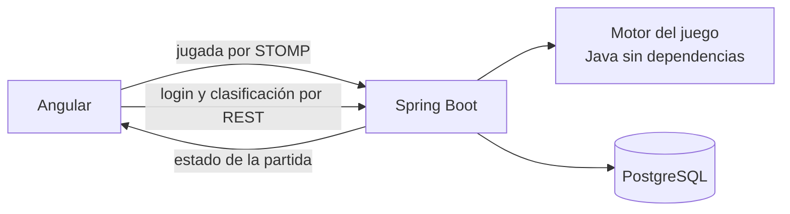

# Regicide: de JavaFX a la web

Caso de estudio de la migración. Recoge de dónde parto, qué quiero conseguir, las decisiones que tomo y por qué, y en qué fase está el trabajo. Lo actualizo al cerrar cada fase.

## Resumen

Regicide fue mi proyecto final de Programación en DAM: un juego de cartas en JavaFX, hecho en cuatro días, que solo funcionaba en mi ordenador. Lo llevo a la web con las reglas en un servidor Spring Boot, la partida en tiempo real por WebSocket, cuentas de usuario y una clasificación. El juego tiene que ser el mismo; lo que cambia es dónde vive cada parte.

## Punto de partida: la versión 1

La versión entregada está en la rama [`v1`](https://github.com/manzzaano/Regicide/tree/v1). Funciona y se puede jugar entera, pero está pensada para un único programa de escritorio:

| Lo que encontré | Por qué impide llevarlo a la web |
|---|---|
| Las reglas están dentro de `ControladorJuego` (499 líneas), mezcladas con los botones y las imágenes | No se pueden ejecutar en un servidor sin arrastrar JavaFX |
| La fase del turno es un texto (`"ataque"`, `"defensa"`) | Nada impide una acción fuera de su fase |
| Las partidas y las estadísticas se escriben en `src/main/resources` con rutas relativas | Solo funciona desde la carpeta del proyecto, y en un servidor varios jugadores escribirían en los mismos ficheros |
| El número de partida se calcula contando los ficheros guardados | Dos partidas a la vez tendrían el mismo número |
| JUnit está en el `pom.xml`, pero no hay ningún test | No hay forma de saber si una regla sigue igual después de moverla |
| 64 ficheros compilados (`target/`, `out/`) están en el repositorio | Ruido en cada cambio |

El modelo (`Juego`, `Baraja` y las cartas) sí se puede aprovechar, y las reglas del juego son las que quiero mantener.

## Un primer intento

Antes de este trabajo hice una primera versión web, guardada en la rama [`web-old`](https://github.com/manzzaano/Regicide/tree/web-old). Al revisarla vi que no cumplía lo que quería contar de ella: el estado de cada partida se enviaba a todos los jugadores conectados, no tenía tests, las partidas jugadas no se guardaban en el servidor y GitHub marcaba 95 vulnerabilidades en sus dependencias. En vez de parchearla, empiezo otra vez desde v1, por fases y con tests desde el principio.

## Objetivo

- **La partida vive en el servidor.** El navegador envía la jugada; el servidor la valida, la resuelve y devuelve el estado nuevo.
- **Cada turno es una máquina de estados:** ataque, defensa, victoria y derrota.
- **Las reglas de v1:** poderes de los palos, el as como compañero y dos comodines.
- **Tiempo real con WebSocket y STOMP,** y cada jugador recibe solo su partida.
- **Cuentas y clasificación** con JWT, Spring Security, PostgreSQL y JPA.
- **El sistema completo se levanta con Docker Compose** y se publica para que se pueda jugar desde cualquier navegador.

## Decisiones

| Decisión | Por qué | Lo que descarto |
|---|---|---|
| El motor del juego es Java sin Spring ni JavaFX | Se prueba con tests rápidos y no depende de cómo se muestre | Reglas dentro de los controladores, como en v1 |
| Las fases son un `enum` y cada acción comprueba la fase | Una jugada fuera de turno se rechaza en un solo sitio | La fase como texto |
| El `Random` se pasa al motor desde fuera | Los tests reparten siempre las mismas cartas y son repetibles | Barajar dentro del motor sin control |
| Cada jugador recibe su estado en `/user/queue/partida` | Nadie ve la partida de otro | Un tema compartido (`/topic/game`), el fallo de la primera versión |
| El estado que se envía no incluye el orden de la posada | El cliente no puede saber qué carta viene | Enviar el objeto del juego entero |
| El servidor guarda la partida al terminar | Es quien sabe el resultado | Un endpoint donde el cliente diga "he ganado" |
| Se puede jugar sin cuenta | La cuenta solo hace falta para aparecer en la clasificación y retomar partidas | Obligar a registrarse para probar el juego |
| Con cuenta, la partida a medias se guarda en PostgreSQL tras cada jugada | v1 permitía guardar y cargar una partida (lo pedía la entrega 2); así el juego sigue siendo el mismo | Perder la partida al cerrar el navegador, o un botón de guardar que el jugador puede olvidar |
| Esquema de base de datos con migraciones de Flyway | Cada cambio de tablas queda versionado | `ddl-auto: update` |
| Sin `JWT_SECRET` o sin base de datos, el backend no arranca | Un error de configuración se ve al momento | Valores por defecto inseguros |
| La interfaz solo tiene modo oscuro | Sigue la estética de mi portfolio y con un único tema es más fácil cuidar el contraste: el texto, el gris secundario y el rojo pasan de 4,5:1 (AA) sobre el fondo y las cajas | Un modo claro que habría que mantener y comprobar dos veces |
| Seis jugadores de ejemplo en la base de datos, marcados como simulados | El primer jugador ve una clasificación con quién medirse. Su mejor partida va de 0 a 6 enemigos derrotados, sin victorias (migración `V4`), así que superarlos a todos pide pasar de la mitad del castillo, y nadie puede entrar con sus cuentas | Una clasificación vacía al estrenar la web |
| Todo en una máquina virtual gratuita de Oracle Cloud, con el mismo Docker Compose y Caddy delante | El servidor está siempre encendido, la base de datos no caduca y la web y la API comparten dominio, así que el WebSocket no cruza orígenes | Planes gratuitos que duermen el servidor sin visitas o borran la base de datos pasado un tiempo, y el frontend en Vercel con la API en otro dominio |

## Versiones

| Pieza | Versión |
|---|---|
| Java | 21 |
| Spring Boot | 4.1 |
| Angular | 22 |
| PostgreSQL | 18 |

## Fases

| Fase | Contenido | Estado |
|---|---|---|
| 1 | Motor del juego en Java, con tests de cada regla | Terminada |
| 2 | Backend: la partida por WebSocket | Terminada |
| 3 | Cuentas y clasificación | Terminada |
| 4 | Frontend en Angular | Terminada |
| 5 | Docker Compose y CI | Terminada |
| 6 | Publicación | Terminada |
| 7 | Seguridad de las cuentas | Terminada |
| 8 | La web en inglés | Terminada |

Cada fase se desarrolla en la rama `dev` y llega a `master` con un pull request.

### Fase 1. Motor del juego

1. Proyecto Maven del backend con JUnit 5.
2. Modelo: cartas, palos (`enum`), enemigos, mano, posada, descarte y castillo.
3. Reparto inicial: 8 cartas del 1 al 10 en la mano, el castillo con jotas, reinas y reyes barajados por grupo y el resto en la posada.
4. Máquina de estados: `ATAQUE`, `DEFENSA`, `VICTORIA` y `DERROTA`.
5. Ataque: una carta, varias del mismo número que sumen 10 como máximo, o un as junto a una única carta.
6. Poderes de los palos e inmunidad contra un enemigo del mismo palo.
7. Enemigo derrotado: con la vida justa a 0 pasa a la posada; si no, al descarte.
8. Defensa: descartar hasta cubrir el ataque del enemigo.
9. Comodines: dos por partida; descartan la mano y roban 8 cartas.
10. Fin de partida.
11. Retirar el código JavaFX de `master`; queda en la rama `v1`.

Terminada cuando todas las reglas tienen tests en verde y una partida completa se juega desde un test.

**Resultado.** El motor está en `backend/src/main/java/com/regicide/juego`: seis clases y 333 líneas, frente a las 499 de `ControladorJuego` en v1. `Partida` es la única con lógica y expone tres acciones (`atacar`, `defender` y `usarComodin`); una jugada que las reglas no permiten lanza `JugadaNoValida` con un mensaje para el jugador. Tiene 74 tests: 54 de reglas concretas y 20 partidas completas con semillas distintas, que comprueban en cada turno que las 52 cartas siguen en juego. Al escribir los tests de cada regla salieron los seis fallos de v1 que recoge la tabla de reglas.

### Fase 2. La partida por WebSocket

1. Endpoint STOMP y acciones: empezar, atacar, defender, usar comodín y abandonar.
2. Una partida por jugador, con el estado enviado solo a quien juega.
3. Validación de cada mensaje: cartas que están en la mano y acción permitida en la fase.
4. Errores devueltos al jugador como mensaje.
5. Las partidas abandonadas se borran al cerrarse la conexión.
6. Tests de integración del flujo completo.

Terminada cuando una partida se juega entera con un cliente de test y dos jugadores a la vez no ven la partida del otro.

**Resultado.** El paquete `com.regicide.partida` conecta el motor con STOMP. El navegador abre `/ws` y envía sus jugadas a `/app/partida/empezar`, `atacar`, `defender`, `comodin` y `abandonar`; el estado vuelve solo a esa conexión en `/user/queue/partida` y los errores en `/user/queue/errores`. Cada conexión tiene una partida en memoria, que se borra al abandonar o al desconectarse. El servidor procesa en orden los mensajes de cada conexión, así que dos jugadas seguidas del mismo jugador nunca se cruzan. El estado que se envía (`EstadoPartida`) lleva la mano, el enemigo y cuántas cartas hay en cada mazo, pero no su orden. Los orígenes desde los que se puede abrir el WebSocket se leen de la configuración (`regicide.origenes-permitidos`), así que ese punto de la fase 3 queda hecho para el WebSocket. Se añaden 12 tests de integración con un cliente STOMP real, entre ellos una partida entera por WebSocket, dos jugadores conectados a la vez y mensajes mal formados; el backend suma 86 tests.

### Fase 3. Cuentas y clasificación

1. PostgreSQL con JPA y Flyway.
2. Registro e inicio de sesión con contraseñas cifradas con BCrypt y JWT.
3. El JWT también en la conexión STOMP.
4. Partida guardada por el servidor al terminar, si el jugador tiene sesión.
5. Partida a medias: con sesión, el estado completo (mano, posada en su orden, descarte, castillo, comodines y fase) se guarda tras cada jugada y se retoma al volver a conectarse. Sin cuenta, se pierde al cerrar la conexión.
6. API REST: `POST /api/auth/register`, `POST /api/auth/login`, `GET /api/leaderboard` y `GET /api/games/me`.
7. Orígenes permitidos (CORS y WebSocket) leídos de la configuración.
8. Tests de seguridad: rutas protegidas sin token, token caducado y registro duplicado.

Terminada cuando una partida jugada con sesión aparece en la clasificación y una partida a medias se retoma después de desconectarse.

**Resultado.** El paquete `com.regicide.cuenta` registra jugadores e inicia sesión: la contraseña se guarda cifrada con BCrypt y el servidor responde con un JWT firmado con HS256 que dura 24 horas. Si falla el nombre o la contraseña, el mensaje es el mismo y no dice cuál de los dos está mal. Las rutas públicas ignoran el token, así que uno caducado no impide ver la clasificación. El navegador envía el token en la cabecera `Authorization` del CONNECT de STOMP; sin token se juega como invitado y con un token falso o caducado se rechaza la conexión. Con sesión, el servidor guarda tras cada jugada el estado completo del motor en una columna `jsonb` (una partida a medias por jugador); al volver, el jugador envía `/app/partida/retomar` y recibe la partida tal como la dejó. Al terminar, la partida pasa al historial (`GET /api/games/me`) y cuenta para la clasificación (`GET /api/leaderboard`), que ordena por victorias, después por la mejor partida y, a igualdad, por menos partidas jugadas. Las tablas se crean con dos migraciones de Flyway y Hibernate solo valida el esquema. Los tests de integración levantan un PostgreSQL real con Testcontainers. Se añaden 26 tests: 3 del motor para exportar y reconstruir una partida, 17 de cuentas y seguridad (registro duplicado, datos no válidos, contraseñas de más de 72 bytes, que BCrypt no admite, rutas sin token, token caducado y token firmado con otra clave) y 6 de partidas con sesión; el backend suma 112 tests.

### Fase 4. Frontend en Angular

1. Componentes standalone y rutas con carga diferida.
2. Servicio STOMP con el estado de la partida.
3. Pantallas: inicio, partida, reglas, clasificación, registro e inicio de sesión.
4. La partida solo pinta el estado y envía jugadas; no calcula ninguna regla.
5. Las imágenes de las cartas de v1.
6. Diseño adaptado a móvil, tablet y escritorio, en modo oscuro con contraste AA.
7. Tests de los servicios y de los componentes con lógica.

Terminada cuando se juega una partida completa en el navegador, con cuenta y sin ella.

**Resultado.** El frontend está en `frontend/`, en Angular 22 con componentes standalone, signals y sin zone.js. Las cinco pantallas (inicio, partida, reglas, estadísticas y entrar) se cargan en diferido. El servicio `Juego` mantiene la conexión STOMP y el último estado que manda el servidor; la partida solo lo pinta y envía las posiciones de las cartas elegidas, y la única cuenta que hace es sumar los puntos de la selección para mostrarlos antes de confirmar. Con sesión, al conectarse pide `retomar` y, si no hay partida guardada, empieza una nueva. `Sesion` guarda el JWT y lo descarta cuando caduca o el servidor lo rechaza. Las cartas son las ilustraciones de v1 en WebP. En escritorio, la partida, las estadísticas y la pantalla de entrar caben sin scroll. Se añade la migración `V3`, con los seis jugadores de ejemplo, y la clasificación los marca como simulados. El frontend tiene 45 tests con Vitest (servicios de sesión, juego y autorización, y las pantallas de partida y entrar).

Además de los tests, revisé todas las fases contra un servidor arrancado: un cliente STOMP propio comprobó 35 casos (partidas aisladas entre dos conexiones, jugadas ilegales, tokens caducados o manipulados, retomar y abandonar), Chrome sin ventana jugó partidas completas pulsando la interfaz, con cuenta y sin ella, y medí cada pantalla de 320 a 1440 píxeles de ancho. Salieron dos fallos que ningún test veía. El CORS de la API no se aplicaba porque Spring Security solo usa la configuración si el bean se llama `corsConfigurationSource`; en desarrollo no se notaba porque `ng serve` hace de proxy, pero en producción la API habría fallado desde otro dominio. Ahora tiene un test. En móviles de 320 a 360 píxeles, el título de la portada y el abanico de la mano se salían de la pantalla. El backend suma 114 tests.

### Fase 5. Docker Compose y CI

1. Dockerfile del backend y del frontend (nginx), en varias etapas.
2. `docker-compose.yml` con PostgreSQL, backend y frontend, healthchecks que comprueban algo real y un `.env.example`.
3. GitHub Actions: tests del backend, tests y build del frontend y auditoría de dependencias.
4. Dependabot.

Terminada cuando `docker compose up --build` levanta el sistema desde cero y el CI está en verde.

**Resultado.** Cada parte tiene un Dockerfile en dos etapas. El backend se compila con el JDK y se ejecuta solo con el JRE y un usuario sin privilegios. El frontend se compila con Node y lo sirve nginx, que además pasa `/api` y `/ws` al backend: el navegador ve un único origen, como con `ng serve` en desarrollo, y no necesita CORS. `docker compose up --build` levanta PostgreSQL 18, el backend y el frontend en `http://localhost:8081`, y cada servicio espera a que el anterior esté sano de verdad: PostgreSQL con `pg_isready`, el backend pidiendo la clasificación, que consulta la base de datos, y el frontend pidiendo esa misma ruta a través de nginx. Sin `DB_PASSWORD` o `JWT_SECRET` en `.env`, Compose no arranca; `.env.example` trae los dos. El CI de GitHub Actions pasa los 114 tests del backend con PostgreSQL en Testcontainers, los tests y el build del frontend y `npm audit`; en los pull requests revisa además las dependencias nuevas, y al final levanta Compose desde cero y comprueba la web, una ruta de Angular, la clasificación y el registro. Dependabot propone cada semana, contra `dev`, actualizaciones de Maven, npm (Angular en un solo pull request), las imágenes de Docker y las acciones. Al preparar el CI salió que `mvnw` no tenía permiso de ejecución en git, así que en Linux no habría arrancado.

### Fase 6. Publicación

1. Elegir dónde alojar el backend y la base de datos sin coste, comparando sus límites.
2. Frontend en Vercel, apuntando al backend publicado.
3. Comprobar que la web y la API responden y jugar una partida en producción.
4. README con el enlace para jugar y el estado real.

Terminada cuando se puede jugar desde la URL publicada.

**Resultado.** Se juega en [regicide.leosoftware.dev](https://regicide.leosoftware.dev). Comparé Render, Koyeb, Railway, Fly.io, Cloud Run, Neon, Supabase y Oracle Cloud. Los planes gratuitos de plataforma o duermen el servidor tras unos minutos sin visitas, y la partida por WebSocket se corta y tarda en volver, o limitan la base de datos en tiempo o en horas, o son créditos de prueba. Me quedé con una máquina Always Free de Oracle Cloud en Frankfurt (ARM, 2 núcleos y 12 GB) que ejecuta el mismo Docker Compose de la fase 5. Por eso cambié el punto 2 del plan: con el frontend en Vercel, la API y el WebSocket habrían estado en otro dominio, con CORS y orígenes cruzados, mientras que así nginx sigue sirviendo todo desde un único origen. `docker-compose.prod.yml` añade Caddy, que pide y renueva el certificado HTTPS de Let's Encrypt y redirige HTTP a HTTPS; deja el frontend sin puerto propio, limita el origen permitido al dominio publicado y reinicia los contenedores si se caen o si se reinicia la máquina. Los secretos se generaron en el propio servidor y no salen de su `.env`. En producción, el cliente STOMP de la fase 4 pasó 34 de los 35 casos; el que falla es el origen `localhost:4200`, que en producción ya no se admite. Chrome sin ventana jugó una partida completa desde la interfaz, y tras reiniciar la máquina la web volvió sola en menos de un minuto. Al fusionar la fase 5, el CI de `master` encontró un test que fallaba según el reparto: si la primera carta era el 10 de Tréboles, mataba a la sota justo y vaciaba las cartas jugadas que el test esperaba. Ahora ataca con la carta más baja. El despliegue es manual (`git pull` y `docker compose up -d --build` en el servidor), y Oracle puede recuperar una máquina gratuita si pasa una semana casi sin uso.

### Fase 7. Seguridad de las cuentas

Con la web publicada, repasé las cuentas frente al nivel 1 de OWASP ASVS 5.0 (y lo que del nivel 2 cuesta poco) y la guía de contraseñas del NIST (SP 800-63B, revisión 4), a la escala de un juego: el correo es opcional, no se piden más datos personales y hay un solo servidor.

1. Contraseñas según el NIST y cifradas con Argon2.
2. Límite de intentos en el login y en la recuperación.
3. Cerrar sesión de verdad: que un token deje de valer antes de caducar.
4. Recuperar la contraseña con un correo opcional.
5. Cambiar la contraseña y borrar la cuenta.
6. Cabeceras de seguridad en la web.

Terminada cuando cada punto tiene su test y la web funciona con la política de contenido activada.

**Resultado.**

| Requisito | Cómo se cumple |
|---|---|
| Contraseñas de al menos 15 caracteres, hasta 128, sin reglas de composición (ASVS 6.2.1, 6.2.5; NIST) | Se cuentan caracteres, no bytes, así que las tildes y los emojis valen uno. La pista de la pantalla sugiere una frase |
| Sin recortar la contraseña (ASVS 6.2.8) | BCrypt solo usaba los primeros 72 bytes; Argon2id no tiene ese límite |
| Ni el nombre ni contraseñas filtradas (ASVS 6.2.4, 6.2.12; NIST) | Se comprueba contra Have I Been Pwned con k-anonimato: solo salen 5 caracteres del SHA-1 |
| Cifrado lento y con sal (OWASP) | Argon2id con los parámetros mínimos de OWASP (19 MiB, 2 pasadas). Las contraseñas en BCrypt siguen valiendo y se pasan a Argon2 cuando su dueño entra |
| Pegar y usar gestores de contraseñas (ASVS 6.2.7) | Los campos llevan `autocomplete` y el botón de mostrar |
| Frenar los ataques a ciegas (ASVS 6.1.1, 6.3.1) | 10 fallos por nombre y 30 por IP cada 15 minutos, en el login, la recuperación y la contraseña actual. Al pasarse, 429 |
| No delatar qué nombres existen (OWASP) | Mismo mensaje y mismo tiempo: con un nombre que no existe se compara contra un hash de relleno. El registro sí dice que el nombre está ocupado, porque los nombres ya se ven en la clasificación |
| Cerrar sesión invalida el token (ASVS 7.4.1) | Cada token lleva la versión de sesión del usuario; salir la sube y todos los tokens anteriores, en cualquier dispositivo, dejan de valer. El WebSocket lo vuelve a comprobar en cada jugada |
| Cambiar la contraseña pide la actual y cierra las demás sesiones (ASVS 6.2.2, 6.2.3, 7.4.3) | El dispositivo que la cambia recibe un token nuevo |
| Nombres ofensivos fuera | La clasificación es pública, así que el registro rechaza nombres con insultos, obscenidades o mensajes de odio en español e inglés. Se buscan raíces sin guiones bajos y deshaciendo el leet (`p0lla`), con excepciones para palabras normales que las contienen (computadora, cálculo) |
| Borrar la cuenta (ASVS 7.4.2) | Pide la contraseña y borra en cascada las partidas |
| Recuperar sin preguntas secretas (ASVS 6.4.2) | Con un correo opcional que solo sirve para esto y no cuenta hasta que se confirma con un enlace (24 horas). "He olvidado la contraseña" pide solo el nombre y responde siempre lo mismo; el enlace caduca en 30 minutos, vale una vez, no inicia sesión y cierra todas las sesiones. Como mucho 3 enlaces por nombre cada 15 minutos |
| Enlaces que no se filtran | 256 bits al azar; el servidor guarda su SHA-256. Van tras la almohadilla de la URL, así que no llegan a los logs ni al Referer, y la página los quita de la barra de direcciones |
| Avisar de los cambios (NIST) | Al cambiar o restablecer la contraseña, y al quitar o cambiar el correo, llega un aviso al correo confirmado, que en el último caso es el anterior |
| Cabeceras de seguridad | nginx envía una política de contenido que solo admite scripts propios y prohíbe los iframes, `nosniff`, `no-referrer` y `Permissions-Policy`; Caddy añade HSTS. El build ya no mete en el HTML el script que cargaba el CSS crítico, que la política habría bloqueado |

También hay una página de privacidad (`/privacidad`, RGPD art. 13). La web no necesita banner de cookies porque no tiene cookies, analítica ni publicidad: el token en `localStorage` es imprescindible para el servicio que pide el jugador (LSSI art. 22.2). En producción los logs de los contenedores, que llevan IPs, se limitan a 3 ficheros de 10 MB. Las vulnerabilidades se avisan en privado: `SECURITY.md`, `/.well-known/security.txt` (RFC 9116) y el aviso privado de GitHub.

Lo que dejo fuera, a propósito:

- **Correo obligatorio.** Sería pedir un dato personal a quien solo quiere jugar. Primero probé con un código de recuperación que se mostraba al registrarse, pero quien olvida la contraseña tampoco suele guardar el código. Los correos los envía Resend, como encargado del tratamiento; sin `RESEND_API_KEY` no se envía nada. Quien no pone correo y olvida la contraseña pierde la cuenta, y así se avisa al registrarse.
- **Cookie `HttpOnly` en vez de `localStorage`.** Obligaría a añadir CSRF y a cambiar la conexión STOMP. Lo compensan la política de contenido, que no deja ejecutar scripts ajenos, y que un token robado se puede revocar.
- **Have I Been Pwned caído.** Si no responde en 3 segundos, la contraseña se da por buena: un servicio externo no puede impedir registrarse.
- **Límite en memoria.** Se pierde al reiniciar y solo vale con un backend, que es lo que hay.

Los tokens emitidos antes de esta fase no llevan versión de sesión y dejan de valer: hay que volver a entrar una vez. El backend suma 45 tests de cuentas y seguridad (160 en total) y el frontend 13 (58).

### Fase 8. La web en inglés

El portfolio lo pueden leer en otros países, así que la web pasa a tener dos idiomas: español, el de siempre, e inglés.

1. Un selector ES/EN siempre a mano, que recuerde lo elegido.
2. Todos los textos de la interfaz en los dos idiomas, también las reglas y la política de privacidad.
3. Los mensajes del servidor (jugadas no válidas, errores de cuentas y correos) en el idioma del jugador.
4. Que el cliente deje de reconocer errores por su texto.

Terminada cuando cada pantalla se ve entera en inglés, sin scroll en escritorio, y los tests cubren los mensajes en los dos idiomas.

**Resultado.**

| Pieza | Cómo |
|---|---|
| Elegir idioma | El servicio `Idioma` guarda `es` o `en` en una señal y en `localStorage`. La primera vez se elige por el idioma del navegador: español si empieza por `es`, inglés si no. Cambia el `lang` de la página. El selector está en el menú y, en la portada, que no tiene menú, en el pie del panel |
| Textos de la interfaz | Cada componente tiene sus textos en dos objetos, `es` y `en: typeof es`, así que si falta una clave en inglés no compila. Lo que va con números son funciones (`derrotados(n)`). La privacidad, que es texto largo, va en un bloque por idioma. Los títulos de pestaña cambian sin volver a navegar con una `TitleStrategy` propia |
| Mensajes del servidor | El motor ya no lanza textos sino claves (`jugada.combinacion`) con sus argumentos, y un `MessageSource` de Spring las traduce con `messages.properties` y `messages_en.properties`. La API lee `Accept-Language`, que el interceptor añade a cada petición. En STOMP la cabecera va en el CONNECT y se guarda en la sesión del WebSocket. Los correos salen en el idioma de la petición que los provoca |
| Errores con código | Los errores de la partida llevan `codigo` además de `mensaje`. El cliente sabe que no hay partida guardada por `partida.sin-guardada`, no comparando el texto en español |

Lo que dejo fuera, a propósito:

- **i18n de Angular (`@angular/localize`).** Compila una web por idioma y cambiar de idioma recarga la página; para unos cientos de textos, dos objetos por componente son más simples y el cambio es al instante.
- **Reconectar al cambiar de idioma a mitad de partida.** Los errores siguen en el idioma con el que se conectó hasta la siguiente conexión; reconectar a un invitado le haría perder la partida.
- **URLs por idioma (`/en/...`).** Solo importarían para buscadores, y el juego no vive de ellos.

El backend suma 2 tests de idioma (162 en total) y el frontend 4 (62).

## Reglas: cambios respecto a v1

Las reglas del juego son las que fijé para el proyecto en clase: los enunciados de las cuatro entregas y el reglamento oficial de Regicide en español (Devir), que v1 abre desde el botón "¿Cómo jugar?". Al pasar v1 al motor encontré seis puntos en los que el código no cumplía ese reglamento. En la versión web se corrigen:

| Regla | En v1 | Según el reglamento |
|---|---|---|
| Tréboles contra un enemigo de Tréboles | Dobla el daño igualmente | No lo dobla: cada enemigo es inmune al poder de su palo, también Tréboles. La entrega final también lo pedía ("tener en cuenta el palo de los enemigos") |
| Compañero animal (as) | Se pueden juntar varios ases con otra carta | El as se juega solo o con una única carta, que puede ser otro as |
| Cartas curadas con Corazones | Van encima de la posada y se roban enseguida | Van debajo de la posada |
| Cartas jugadas contra un enemigo derrotado con la vida justa | Se quedan en el mazo de jugadas | Pasan al descarte, igual que cuando se derrota con daño de sobra |
| Comodines al defenderse | No se pueden usar | Se pueden usar al empezar el paso 1 (antes de atacar) o el paso 4 (antes de recibir daño) |
| Figuras robadas de la posada | Valen su número: 11, 12 y 13 | La sota vale 10, la reina 15 y el rey 20 |

Lo que el reglamento deja a elección o no aplica a una partida de un jugador se queda como en v1: no se puede pasar el turno y no hay niveles de victoria (oro, plata y bronce).
